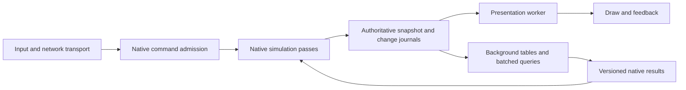

# Responsive simulation: architecture and optimization plan

## 1. Objectives and ranked findings

Optimize **player action → authoritative effect → visible feedback in milliseconds**, alongside sustained throughput and movement smoothness. Prioritize gameplay spikes, then ordinary step cost. Command admission, attacking, worker activity, production and presentation all belong to this pipeline.

This plan uses code inspection and the historical profile in [OPTIMIZATION_PROGRESS.md](Z:/data/gitrepos/aleksiklasila.github.io/rng/defence3/OPTIMIZATION_PROGRESS.md:8502). No further benchmarks or profiling runs belong to this planning session. Historical timings establish scale; they do not establish current speedups or regressions.

The approximately 34 ms outside parallel kernels must not all be labelled JavaScript: that remainder can include serial WASM, orchestration and waits. The code nevertheless identifies substantial per-item JS and serial work that should disappear.

| Opportunity | Historical cost/context | Removable work identified in code | Priority |
|---|---|---|---|
| Navigation publication and dependent waits | `navTick` spikes +20–28 ms; worker commit +10–13 ms two steps later | Missing fields computed during installation; field-slot scans and copies; background chains collected unfinished | First: direct hitch source |
| Foreground preparation and commits | Worker search 8.4 ms; events 6.8 ms; additional smaller calls | JS candidate preparation, result compaction, object reconstruction, event dispatch and exceptional gameplay paths | First: direct critical-path savings |
| Repeated shared queries | Effective stats 16 ms helper CPU; worker search 41 ms, plus site preparation | Repeated graph traversal for identical keys; return-site grids and distance fields rebuilt despite unchanged eligibility | Early: promising waste removal |
| Flow requests | Exact looks 49 ms helper CPU; posting 2.5 ms foreground | Per-unit duplicate requests/results; population-sized scans; answers discarded after nav installs; request-count-based added latency | Early, together with navigation |
| Acquisition and combat decisions | Acquisition lane about 166 ms helper CPU | Repeated classification, grouping and gathering; repeated area queries; stale answers causing delayed attacks | High: substantial CPU and response impact |
| Visibility | Seeds 40 ms; spread 15 ms helper CPU | Many units repeatedly update the same area/viewer seed; duplicate snapshot and membership processing | High: seed reduction before spread redesign |
| Physical layout and indexes | Relayout 7.3 ms wall; slot moves 48 ms CPU; acquisition snapshot 41 ms CPU | Moving cold columns with hot state; remapping references; repeated slot-extent scans and derived copies | Foundational, larger change |
| Movement | Approximately 42 ms wall for k89+k8; movement family about 425 ms CPU | Branch-heavy per-unit resolution, repeated gathers, collision retries and duplicated epilogues | Large redesign, correctness-gated |
| Production, status and other smaller paths | Individually smaller; no reliable current isolated totals | Full spawner scans, JS stat-table repair, large fixed sorting histograms, inactive structure-status scans | Include early where changes are contained |
| Presentation buffering | Outside the historical simulation profile | Unit motion playback targets roughly 1.4–2 snapshot intervals behind the newest snapshot | Separate response-latency workstream |

These costs overlap and must not be summed. Rank implementation work by **critical-path reduction, eliminated CPU/memory traffic, confidence and effort**, rather than repeatedly selecting only the largest kernel.

## 2. Target architecture and contracts

The intended flow is:

Background work consumes immutable, explicitly versioned inputs. The simulation applies results at deterministic logical boundaries. Presentation consumes completed authority without blocking it.

**Data ownership**

- Simulation state, derived tables, query preparation and per-item commits live in WASM. Convert each producer → computation → consumer slice together.
- JS remains responsible for network/browser interfaces, scheduling calls and UI. It does not manufacture per-unit rows, interpret declined gameplay events or repair missing native state.
- Extend existing stable handles with generation validation where needed. Physical hot-row locations are implementation details; asynchronous results and long-lived references use stable identity.
- Keep cold state separate from dense, block-local hot columns. Use 64-row SoA blocks, matching existing slab organization and SIMD widths.
- Every retained column needs a documented producer, consumer, lifetime and invalidation rule. Remove unused placeholders and duplicated derived values. Sparse worker/status/order state remains sparse.

**Native interfaces**

- **Command batches:** existing action identity, deterministic sequence, admitted tick, command payload and packed entity selection. Preserve the wire format initially; decode and validate numeric entity lists natively.
- **Change journals:** native append buffers for births, deaths, membership changes, structure eligibility, commands, research and topology. Parallel producers use counts/prefix sums and deterministic merging.
- **Background jobs:** source epoch, dependency versions, scheduled commit epoch, input/output spans and native stage descriptors.
- **Results:** compact query answers plus only the consumer identity/version information needed for validation. Shared answers are referenced, not copied into every entity.
- **Publication:** a small generation/root update after native validation and bulk application. Never a JS walk over the result population.

Peer outcomes must not depend on helper completion order. If required work misses its deterministic boundary, correctness still requires waiting; the optimization is to remove and distribute that work, not silently use different results on different peers.

Keep the working set within the existing WASM32 memory budget. Avoid tables proportional to every combination of unit, area, owner, range and generation. Retain only live query keys and generations still referenced by scheduled jobs.

## 3. Subsystem implementation

### A. Commands, foreground JS and native commits

The current command implementation already applies admitted actions whole; old comments about spreading orders across budgets are misleading. Preserve that behavior.

Complete native handling for:

- `_ordPickPublish`, `_orderWorkers` and `orderPickupFinish`: destination preparation, exceptional workers, held units, pending routes, counters and completion.
- `_wsPost`, `_wswStep` and `waiTake`: candidate preparation, healer lists, work-site changes, reservation state and missing stat rows.
- `waiOutEvents` and `unitEventsRun`: manual workers, pending paths, movement/shooting combinations, route clearing, mine transitions, construction and research.
- Movement output handling, structure-hit aftermath, retirement and presentation dirty records.

The explicit `OUT_DECLINED` path in [wai.rs](Z:/data/gitrepos/aleksiklasila.github.io/rng/defence3/wasm/src/wai.rs:1118) currently returns unsupported gameplay cases to JS. Remove it only when all those cases and their state are native; do not retain a production fallback.

Replace generic raw-address write/add replay in `k_wai_apply` with typed intents grouped by destination:

- Reservation claims retain deterministic winner rules.
- Resource transfers and queue payments retain ordering and conservation.
- Independent targets apply in parallel.
- Noncommutative operations use stable ordering; floating-point reductions must not depend on helper scheduling.

Native compaction should produce changed-item lists directly. Remove JS scans that rebuild those lists from kernel flags.

### B. Shared queries, worker sites and production

**Effective levels.** `k_eff_units` repeats area graph searches for due units sharing the same query. Generate unique keys:

`(histogram epoch, graph epoch, area, owner, type, radius)`

Compute each neighborhood count once, then apply results over contiguous due-unit columns with SIMD. Preserve individual base stacks, level transitions, energy adjustment and refresh cadence. Count each reachable area once; ordinary graph convolution would incorrectly count multiple paths.

Build static and research-derived stat tables entirely in WASM at initialization or the relevant change event. Eliminate JS repair of missing rows.

**Worker return sites.** `k_worker_sites` currently reconstructs site blocks and owner/type distance fields when worker-event batches run. Maintain them from structure changes:

- Placement/removal, ownership/type changes, construction completion and energy crossing zero invalidate eligibility.
- Rebuild only changed site blocks.
- Recompute distance fields only for affected owner/type combinations.
- Retain exact nearest-site selection and deterministic tile tie-breaking.

**Worker searches.** Group requests by compatible owner, work kind, source-area set, range and graph epoch. Share reachability walks and candidate buckets; retain each worker’s current-target preference, scoring and reservation outcome. Existing ring pruning and packed SIMD site filtering already exist and should be retained.

**Production.** Replace two full spawner-row passes and JS stat repair with a native changed-spawner journal. Maintain an ordered ready set per owner:

- Payment, queue, pause, construction, ownership and stat changes update readiness.
- Newly ready entries receive tickets in deterministic tile order.
- Population changes reconsider waiting ready entries.
- Selection visits eligible ready entries, then births and queue shifts execute natively.
- Preserve payment carry, queue ordering, population limits and birth identity allocation.

This also removes unnecessary large histogram clears/sorts when few or no spawners are ready.

### C. Navigation, exact flow and spikes

The concrete foreground problem is [_navNextInstall](Z:/data/gitrepos/aleksiklasila.github.io/rng/defence3/src/game/flownav.js:1154): it scans field slots, builds missed fields synchronously and copies field contents between installed/next arrays.

Replace this with:

1. **Per-profile immutable generations.** Graphs and fields use profile-owned arenas and generation roots. Unchanged chunks are shared; publication does not copy unrelated profiles.
2. **Native dependency tracking.** Requests arriving during a build enter that generation’s native preparation chain. Installation contains no missing-field discovery or graph search.
3. **Incremental topology work.** Rebuild dirty clusters, their boundary connectivity and affected ancestors. Splits and distant connectivity changes propagate through actual dependencies; local wall checks alone are insufficient.
4. **Deterministic publication.** Install the required graph/field generation at its scheduled logical boundary. Reclaim old chunks only after all readers finish.
5. **Small executable stages.** Split graph/field work into parallel ranges and frontier stages so a collect cannot inherit several large indivisible jobs.

For exact flow:

- Generate requests from changed steering state and invalidation journals, rather than rescanning all slots after movement.
- Deduplicate by the complete dependency key: source tile, destination, movement profile, navigation generation, wall dependencies and field generation.
- Produce one answer per unique query, with compact references from dependent entities.
- Resolve identity through stable handles; remove per-result binary searches and slot-remap work.
- Remove the extra delay proportional to `floor(pending / 131072)`. Scratch batching is allowed; population-dependent gameplay delay is not.
- Pin query inputs to immutable generations. Validate against the generation required at commit, not whichever build happened to exist while a helper ran.

Preserve the native coarse steering available while exact guidance is being prepared. It must obey current walls and accept new commands immediately.

Do not repeat the previously unsuccessful fixes—longer nav windows, rushing whichever lane is currently awaited, or dropping build checks without replacement dependencies. Those moved contention or weakened freshness.

### D. Acquisition, attacking and turrets

Treat snapshot creation, area grouping, sampling, combat decisions and foreground validation as one pipeline.

- Produce compact spatial/acquisition records from native state publication. Avoid classifying the same units and gathering their slot columns repeatedly.
- Cache structure classification and area answers by their actual seed, visibility and topology dependencies. A new tick alone is not an invalidation.
- Group compatible queries by area, viewer and reach. Process contiguous candidate batches with SIMD, while retaining per-unit sampling and current-target preferences.
- Reuse the existing staged batch work in acquisition sampling and combat brain; do not discard improvements already present.

Freshness is part of performance. A cheap stale answer that postpones firing is not a successful optimization.

Retain a small ranked candidate set for combat-active consumers, using the existing candidate sampling rather than a new broad search. At commit, validate identity/generation, liveness, visibility, range and command sequence. Use a valid alternate when the first candidate died; do not send failures to JS or perform a synchronous foreground area search.

Explicit player targets and newer commands override older autonomous answers. Towers consume the same versioned candidate infrastructure. Remove avoidable waiting for another full acquisition cycle when an already-computed valid alternative exists.

Do not change damage, cooldown accounting or target allocation merely to lower CPU. Validate attack timing and useful combat activity alongside cost.

### E. Visibility, statuses and secondary work

Visibility seeds have more obvious redundancy than the graph spread itself.

- Reduce contributors to maximum sight range per `(area, viewer)` before publication, replacing repeated atomics from many units.
- Reuse compatible area membership data, preserving visibility’s current pre-movement observation point.
- Update changed contributor buckets for movement-window crossings, births/deaths, watch changes and stat changes.
- Handle decreases correctly: removal of the last maximum contributor requires repairing that bucket. A max-only cache cannot support deaths or shrinking range.
- Initially retain exact graph spreading for affected viewers; eliminate duplicate seed work before attempting a more complicated incremental propagation algorithm.

For statuses and damage:

- Keep active status records and expiration schedules natively, avoiding scans of inactive structure rows.
- Preserve the existing touched-target hit application; it already avoids applying hits over the whole population.
- Emit watch, death, ownership and presentation changes directly into native journals.
- Fuse compatible position/status snapshot work into existing passes without moving reads across gameplay phase boundaries.

Traffic and heap maintenance remain explicit targets. Share per-tile traffic coefficients and batch deposits. Preserve the dependency structure of traffic’s iterative solver; blindly fusing its dependent iterations is unsafe. Reduce clearing and copying by using complete native record initialization and sparse state pools, with no reads of uninitialized reused storage.

### F. Hot/cold layout, indexes and memory traffic

Current relayout moves all registered slot columns and forces consumers to remap references. The mover cache then still gathers substantial state back from those slots.

Make hot rows authoritative:

- Store the position, movement, collision, control and frequently consumed stat references needed by the hot passes.
- Keep rare worker state, long orders, presentation metadata and other cold fields behind stable handles.
- Move hot rows only for birth/death and block/class migration; do not move the entire cold entity record.
- Emit spatial membership, traffic, visibility contribution, flow-request and presentation changes from native epilogues.

Use block-local index segments. Rebuild changed blocks and publish their descriptors; avoid a global per-unit merge/remap after every local change. Preserve deterministic ordering only where it affects behavior.

Distinguish **live entities, active movers, occupied rows, high-water extent and allocated capacity**. Kernels should iterate the appropriate population. Empty-slab skipping helps, but it does not remove costs from sparsely occupied slabs.

This replaces the earlier unsuccessful incremental-index approaches structurally; merely enabling an old delta flag is not the plan.

### G. Movement redesign

Use [MOVEMENT_SIMD_PLAN.md](Z:/data/gitrepos/aleksiklasila.github.io/rng/defence3/MOVEMENT_SIMD_PLAN.md) as a starting point, with these mandatory corrections:

- Claims and ownership indexes use widths that cover supported dense blocks. Do not pack priority into 12 bits.
- Footprint descriptors cover every supported shape/radius, not only 1/3/5-cell classes.
- Halo and job independence derive from actual displacement, footprint and swap reach.
- Candidate validation includes swept-path conflicts and crossings, not just destination occupancy.
- Vacating dependencies propagate to completion. A fixed number of propagation iterations is not sufficient.

Implement the prototype as:

1. SIMD intent generation over authoritative hot rows.
2. Block-local wall/occupancy masks and footprint descriptors.
3. Batched candidate generation and deterministic claims.
4. A reverse dependency graph for occupied cells that accepted movers must vacate.
5. Rejection propagation through a work queue, visiting affected dependency edges rather than repeatedly rescanning every mover.
6. Explicit handling of permitted swap cycles; reject incompatible cycles.
7. Native commit and one combined change-producing epilogue.

Movement substeps derive from displacement and collision requirements. They are not budgets that defer entities or commands. Preserve intentional short movement, attack stopping and worker movement rules.

The current native resolver remains the production implementation until this prototype passes correctness, crowd-flow and performance gates. The replacement then ships as one native implementation. No JS fallback or behavior-degrading emergency path is added.

Bulk arithmetic, filtering and reductions should be SIMD. Small native graph-control/scatter operations may remain scalar where that does less total work; SIMD percentage alone is not an acceptance metric.

### H. Presentation and end-to-end response

The current **unit motion playback** target is roughly one snapshot interval plus a jitter allowance: normally about 1.4 intervals, rising to two. At 100 ms snapshot spacing, that corresponds to approximately 140–200 ms of simulation-time lag behind the newest snapshot. This is a playback target, not a measured total click latency; some structure/state channels already publish separately.

Preserve smooth interpolation while removing unnecessary response delay:

- Keep a steady playback clock for ordinary motion.
- Express additional jitter allowance in milliseconds, initially `min(50 ms, max(render interval, 3 × arrival jitter))`, rather than a fraction that grows with long simulation intervals.
- When a completed frame contains a newly applied local command, begin that authoritative motion segment on the next draw. Rebase from the currently drawn pose using the native rebase path, rather than jumping position.
- Preserve continuity for unaffected motion and deliver presentation events exactly once when superseded queued frames are skipped.
- Publish confirmed queue/order/target changes promptly through numeric change records.
- Do not extrapolate gameplay or count immediate click markers as commands taking effect.

Retain fair lockstep admission and sealed-packet rules. Continue basing admission on completed authority, not the older presentation clock. Avoid adding another private queue of simulation steps.

## 4. Implementation sequence and compatibility

Implement complete native slices in this order:

1. Add action-to-effect trace identities and native journal/result primitives. Complete command pickup and worker-event exceptions.
2. Remove repeated effective-level queries, unchanged worker-site rebuilds and production preparation/selection waste.
3. Replace navigation installation and flow request/result ownership together.
4. Rework acquisition and visibility producers/consumers around shared versioned records.
5. Make hot rows authoritative and replace full-record relayout/global remapping.
6. Implement and gate the movement prototype.
7. Integrate presentation response changes early enough to evaluate them alongside simulation improvements, rather than treating rendering as an afterthought.

Each slice removes its superseded state and JS path when it lands. No intermediate JS row-builder or permanent dual implementation.

Keep current network action formats initially. Version snapshots when state ownership changes; restore through native reconstruction of authoritative tables, journals and derived generations. Hash logical state independently of physical layout. Historical bit-for-bit equality is diagnostic; cross-peer and cross-helper determinism is mandatory.

## 5. Validation and acceptance for the implementation session

No validation runs are requested during this planning session. Later timing comparisons run serially after competing work has stopped.

**Responsiveness**

Trace the existing action identity through input, packing, admission, native application, first meaningful effect, presentation publication and first draw. Record first/median/last affected entity for large selections.

Measure separately:

- Command acceptance versus actual movement or changed heading.
- Attack order versus target adoption and first permitted attack.
- Tower target change versus firing.
- Queue change versus payment, readiness and birth.
- Worker assignment versus travel and useful work.

Use originating-client wall time for end-to-end measurements; do not subtract unsynchronized clocks from different peers. Report p50/p95/p99/max in milliseconds, with admitted-step counts only as supporting data.

**Spikes and useful throughput**

Use the existing previous/slow/next/reference-tick method after implementation, including matching action-burst status and helper activity. Separate JS, serial WASM, foreground parallel work, background catch-up, waits, GC and presentation.

Retain raw traces, actual populations, slow-tick counts, useful worker/combat throughput, background answer age and discarded-result counts. A lower mean caused by less useful gameplay is a failure.

**Correctness and behavior**

- Determinism across 0/1/3/8/11 helpers, resync, restore and different physical layouts.
- Command supersession during pending searches, nav rebuilds and row migration.
- Topology splits/merges, late field requests and generation retirement.
- Candidate death, visibility loss, ownership changes and stale handles.
- Worker reservations, payment conservation, queues, research and population limits.
- Dense counterflow, plugs, narrow passages, long dependency chains, swaps, varied footprints and long steps.
- Step sizes including 1, 2, 3, 4, 8, 16 and 20, preserving current step-size accounting.
- Headed multiplayer presentation tests; headless playback bypasses buffering and cannot establish visible responsiveness.

Require zero invalid overlaps, wall crossings, accounting errors or peer divergence. Use the movement plan’s existing behavioral gate: aggregate progress within 5% and fixed-time arrival within five percentage points, with no persistent freezes or artificial queues hidden by aggregate scores.

Accept a change when it removes demonstrated work or memory traffic, improves the relevant response/tail metric, and preserves useful behavior. Record results and remaining bottlenecks in `OPTIMIZATION_PROGRESS.md`.

Defaults: large structural changes are allowed; no simulation JS fallbacks, no arbitrary per-tick work caps, no increased background staleness to manufacture throughput, and no promise that scheduling alone can solve a saturated CPU or memory system.
